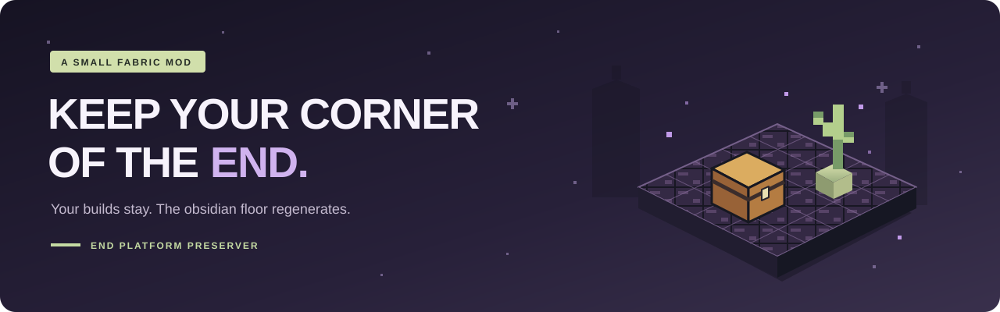

<div align="center">



# End Platform Preserver

**Build a better welcome to the End. Keep it there.**

A small Fabric mod that preserves the blocks above the End arrival platform<br>
when players, mobs, items, or other entities travel through an End portal.


[](LICENSE)

[Why use it?](#a-platform-worth-coming-home-to) · [Install](#installation) · [Commands](#your-world-your-rules) · [FAQ](#good-to-know) · [Build from source](#build-from-source)

</div>

---

## A platform worth coming home to

A welcome station. A chest of supplies. A redstone project. Vanilla platform generation clears the space above the End arrival platform every time something comes through. End Platform Preserver lets your work stay in place.

| What happens on arrival? | Vanilla | Preservation enabled |
| :--- | :---: | :---: |
| The 5 × 5 obsidian floor regenerates | Yes | Yes |
| The three layers above the floor are cleared | Yes | **No** |
| Blocks, fluids, and chests in those layers stay in place | No | **Yes** |
| Entity arrival positions change | No | No |

- **Ready from the first arrival.** Preservation is enabled by default.
- **Made for singleplayer and servers.** On multiplayer servers, players do not need to install the mod.
- **One setting, per world.** Switch behavior with Minecraft's built-in `/gamerule` command; the setting saves with the world.
- **No Fabric API dependency.** Just Fabric Loader and this mod.

> **Plan a clear landing spot.** Arrival positions stay vanilla. Leave enough room for incoming players and other entities to avoid colliding with your build. The obsidian floor itself is still regenerated, so blocks placed in that floor can be replaced.

## Installation

| Requirement | Version |
| :--- | :--- |
| Minecraft Java Edition | **26.3** |
| Fabric Loader | **0.19.5 or newer** |
| Java | **25 or newer** |
| Fabric API | Not required |

1. Set up a Fabric instance or server for **Minecraft 26.3**.
2. Place `end-platform-preserver-1.1.0+mc26.3.jar` in its `mods` folder, replacing any older copy of this mod. If you are working from source, [build the JAR first](#build-from-source).
3. Restart the game or server. Preservation is already on.

**Where does it go?**

| How you play | Install the mod here |
| :--- | :--- |
| Singleplayer | Your Minecraft client's `mods` folder |
| Multiplayer | The server's `mods` folder; connecting players do not need the mod |

Installing the mod only on a multiplayer client cannot change the server's platform behavior. This release declares compatibility with **26.3 only**.

## Your world, your rules

Use these commands in-game with cheats enabled or operator permissions. In the server console, omit the leading `/`.

**Keep builds above the platform** — the default:

```mcfunction
/gamerule end-platform-preserver:enabled true
```

**Restore vanilla clearing** on the next platform generation or portal arrival:

```mcfunction
/gamerule end-platform-preserver:enabled false
```

**Check the current setting:**

```mcfunction
/gamerule end-platform-preserver:enabled
```

Changes apply immediately and save with the world. Each world has its own setting, and the obsidian floor regenerates in both modes.

> Turning preservation back on protects future arrivals. It does not recover blocks cleared while preservation was off, or blocks destroyed before the mod was installed.

## Good to know

<details>
<summary><strong>What area is protected?</strong></summary>

The three layers directly above the 5 × 5 arrival platform. At the vanilla End arrival location, that is **X 98–102, Z −2–2, Y 49–51**. The floor at **Y 48** keeps its vanilla generation, replacement, drops, and block updates.

Preservation follows the shared platform generation method, including calls made by the End platform feature. It does not provide general protection for the End island or other builds.

</details>

<details>
<summary><strong>Does it preserve chests, fluids, and redstone?</strong></summary>

Yes. The mod skips the clearing operations above the floor entirely, leaving blocks, fluids, and block entities such as chests and their contents in place. It does not prevent damage from other game mechanics.

</details>

<details>
<summary><strong>Does it work when something other than a player enters?</strong></summary>

Yes. The mod changes the shared platform generation method used for portal arrivals, covering players, mobs, items, and other entities.

</details>

<details>
<summary><strong>Can I use it in a modpack?</strong></summary>

Yes. The project uses the [MIT license](LICENSE). Keep the license and copyright notice when redistributing it. Compatibility with other mods that change End platform generation is not established by the verification suite.

</details>

## Build from source

Make JDK **25 or newer** available through `JAVA_HOME`, then run the included Gradle wrapper from the repository root.

**Windows / PowerShell**

```powershell
.\gradlew.bat build
```

**Linux / macOS**

```sh
./gradlew build
```

The installable mod is written to:

```text
build/libs/end-platform-preserver-1.1.0+mc26.3.jar
```

The `-sources.jar` contains source code; use the regular JAR in your `mods` folder.

### Verification

The repository includes a separate runtime verification harness. The [recorded results](verification/RESULTS.md) report that version **1.1.0** passed twenty feature calls in each of the real Fabric client and dedicated-server transformation environments, covering preservation, floor repairs, gamerule commands, and setting serialization. A negative control also rejected the expected vanilla clearing behavior.

These checks use Minecraft's actual transformed platform method with controlled world access. They do not cover interactive portal traversal, a live server world, full save/restart behavior, or real chest NBT serialization.

See the [verification guide](verification/README.md) for setup, reproduction commands, and the full test scope. The harness is separate from the distributed mod.

<details>
<summary><strong>Under the hood</strong></summary>

Minecraft 26.3 is unobfuscated. Two required Mixins make the change:

1. `GameRulesMixin` registers the boolean gamerule during vanilla registry bootstrap, before the registry freezes. Minecraft supplies command handling, permissions, suggestions, and world persistence.
2. `EndPlatformFeatureMixin` changes the exclusive upper bound of the vertical loop in `EndPlatformFeature.createEndPlatform` from `3` to `0` when preservation is enabled. The loop begins at `-1`, so the obsidian floor still generates while the three clearing layers are skipped. Disabling preservation restores the original bound.

Both injections require exactly one match. The mod metadata restricts compatibility to Minecraft 26.3.

</details>

---

<div align="center">

**A little less rebuilding. A little more Minecraft.**

[MIT licensed](LICENSE) · Built for the Minecraft community

</div>
